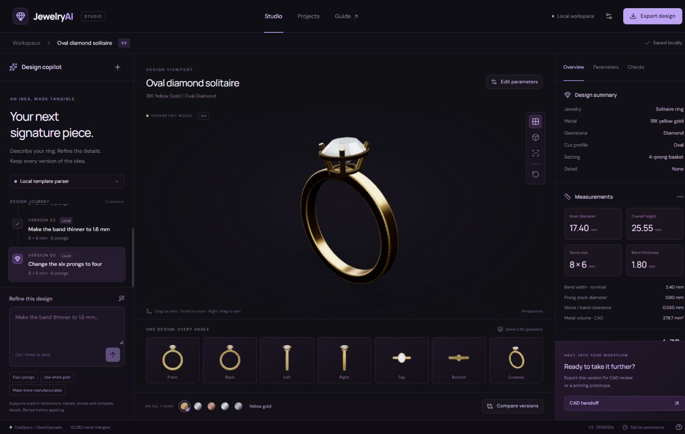

# JewelryAI Studio

A working local ring design prototype. Structured parameters drive a real CadQuery/OpenCascade model, every camera view, geometry-derived measurements, immutable versions, preliminary checks and exports.



The original project briefs are retained in `docs/source-briefs/`, a verified sample STEP file is in `samples/`, and the original handoff package is in `deliverables/`. The briefs describe the broader vision; this README and `MVP-SPEC.md` describe what the current prototype actually implements. Runtime databases, API keys, installed dependencies and build caches are not included in Git.

## Start

On this machine the dependencies and frontend are already prepared. From this directory run:

```powershell
powershell -ExecutionPolicy Bypass -File .\Start-Studio.ps1
```

Open http://127.0.0.1:8765. Keep the terminal running. Stop it with Ctrl+C.

For a new machine, install Python 3.12 and Node.js 22 or newer, run `Setup-Studio.ps1`, then `Start-Studio.ps1`. The setup creates a project-local virtual environment and uses the exact npm lockfile. CadQuery's installation is substantial because it includes a native CAD kernel.

## First workflow

1. The studio opens with a saved starter ring or your last selected version.
2. Enter a supported ring description or revision. Click the arrow or press Ctrl+Enter.
3. Review interpreted parameters and assumptions. Adjust them if needed, then build and save.
4. Inspect the model, seven camera/cutaway views, measurements and evaluated checks.
5. Change parameters, apply recommendations, restore older versions or compare a violet wireframe overlay.
6. Export the selected version. Export never silently selects the newest version instead.

Examples:

- Create an 18K gold ring with an oval 8 x 6 mm diamond and six prongs.
- Make the band thinner to 1.6 mm.
- Change to four prongs.
- Increase the center stone to 9 x 7 mm.
- Use white gold.
- Add milgrain beads.
- Make the design more manufacturable.

## Gemini

The studio works immediately with a **local constrained parser**, which is not an LLM. The UI identifies which interpreter produced each version. The local parser supports explicit dimension and template changes and rejects unsupported jewelry/features and ambiguous ring sizes.

For Gemini, use Settings to enter your own key. It remains in backend memory only and is not saved to SQLite or browser storage. A configured key is not proof of provider connectivity. Alternatively copy `.env.example` to `.env`, set `GEMINI_API_KEY`, and restart. The model can be configured with `GEMINI_MODEL`. Requests use Google's REST API with structured JSON output; Pydantic then validates values. Failed interpretation or geometry generation does not create a version.

The Gemini integration has contract tests with a mocked provider. A real provider call requires your key and is not claimed as verified without one. Using Gemini incurs the provider's normal API usage charges.

## Supported scope

- Solitaire rings with oval or round simplified faceted gemstones.
- Diamond, emerald, sapphire and ruby appearances.
- 18K yellow/white/rose gold, sterling silver and platinum illustrative profiles.
- Four or six tapered prongs, a connected gallery basket and a modeled stone seat.
- Plain or predefined milgrain bead detail.
- Inner diameter and all dimensions in mm. US sizes are converted approximately and explicitly disclosed; bare ring sizes are rejected.

Floral patterns, halo, pavé, filigree, other jewelry types, true supplier-specific gemstone cuts, FEA, casting simulation, global wall-thickness analysis and manufacturing certification are outside this prototype.

## Geometry and exports

The CAD bore is along Y, and CAD Z is up. Every view uses the same tessellated backend solid. GLB converts mm/Z-up to metres/Y-up. The UI meshes are display derivatives of CAD geometry, not an independent frontend ring approximation.

| Format | Actual contents |
| --- | --- |
| STEP | Metal CAD solid, mm; excludes the gemstone |
| STL | Tessellated metal solid; interpret coordinates as mm because STL is unitless |
| 3MF | Metal mesh with explicit mm units |
| GLB | Metal and gemstone with materials, metres and Y-up |
| DXF | A real central XZ planar section of the selected metal geometry; not a complete production drawing |
| JSON | Exact saved design, assumptions, changes, findings and version identity |

DWG, native 3DM and direct AutoCAD/Rhino launch return an explicit not-implemented state. STEP can be imported for CAD review. Export is permitted for a draft; files are not described as production approved. No mesh conversion is presented as recovering original parametric modeling history.

## Measurement and analysis limits

The backend measures the actual CAD bounding box, metal volume, connected-solid count, stone-to-band clearance and post-seat-cut metal/stone intersection. Weight is metal volume / 1000 × illustrative alloy density, not manufacturing material demand. Band thickness/width, prong stock diameter and bead diameter checks use nominal template parameters and illustrative guidelines. They are not a global minimum-wall measurement or a residual prong-strength calculation.

The review reports evaluated passes/failures separately from unassessed items. Any failed evaluated check blocks the “Ready for CAD review” status. This label never means production approval. Global wall thickness, retention strength, actual alloy/process validation and manufacturing allowances remain unassessed. Thresholds live in `backend/analysis.py`; replace and validate them with a jeweler/workshop before any production use.

## Storage

SQLite preserves every version and the selected version across browser reloads and service restarts. Selecting an older version restores it without overwriting anything. Editing it creates a new numbered version in the same project, linked to its parent. Geometry is rebuilt from saved parameters using the recorded generator version. The current code only supports generator `solitaire-1.0`; migrating to a different generator requires an explicit version migration policy.

By default runtime state is in `data/`, ignored by Git. Set `JEWELRYAI_DATA_DIR` to move it. Exports are generated inside version-specific directories. Export responses include version ID and geometry hash headers. API keys are never stored in this database. This localhost app does not implement cloud authentication or multiuser access.

On the prepared machine, the launch script retains the existing runtime at `../../work/jewelryai-runtime` when present, so restarting keeps the designs created during verification.

## Architecture and APIs

Next.js static frontend → same-origin FastAPI service → Pydantic design validation → vetted CadQuery template → geometry analysis → SQLite immutable version → tessellation / real exporter.

`/docs` exposes the live OpenAPI specification. The main endpoints are:

- `POST /api/design/interpret` — propose a design or revision without creating a version.
- `POST /api/design/commit` — validate, build and save the reviewed proposal.
- `POST /api/design/generate` and `/revise` — convenience versions of that workflow.
- `POST /api/design/update` — apply explicit parameter edits.
- `POST /api/design/analyze` — recalculate the chosen saved version's findings.
- `POST /api/design/recommend` — apply an available deterministic recommendation.
- `GET /api/versions`, `GET /api/versions/{id}` — history and version geometry.
- `POST /api/design/select` — persist the selected version.
- `POST /api/design/export` — export an explicit version ID.

The CAD kernel is guarded by a process-wide lock and runs in FastAPI's worker threads. This prototype favors correctness and a single local designer over concurrent throughput. Geometry and display meshes are cached for sixteen physical parameter states; appearance/title changes reuse identical geometry while keeping their distinct saved version identity.

## Verification

Verified on this machine on 10 October 2026: **25 backend tests passed**, TypeScript checking and the production frontend build passed, and the production npm dependency audit reported no known vulnerabilities. Browser checks covered prompt review and revision, persistence after reload, version restoration and comparison, a real STEP download, and a narrow mobile layout. The test runner emitted one upstream Starlette/httpx deprecation warning; it did not affect the passing results. Live Gemini connectivity remains untested without a user-provided key.

Run tests from this directory using the prepared Python virtual environment:

```powershell
..\..\work\jewelryai-venv\Scripts\python.exe -m pytest tests -q
npm.cmd run typecheck
npm.cmd run build
```

The backend acceptance suite checks prompt validation, unrelated-field preservation, stone-dependent geometry, failed-revision preservation, recommendation application, version restoration, export identity and actual STEP/STL/3MF/GLB/DXF contents. STEP is reimported and checked for dimensions/volume; STL is loaded and checked for watertightness. Gemini tests validate the provider contract rather than pretending to call a live model.

## Hosting

The complete app runs locally. Sites uses a Cloudflare Worker runtime, which cannot execute the native Python/OpenCascade engine. Publishing the complete workflow requires a separate Python CAD service with persistent storage and HTTPS, then a frontend configured to use it. No public deployment or remotely working CAD backend is claimed.

